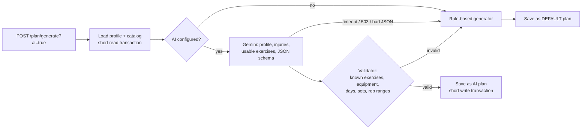

# NextRep

[](https://github.com/fadikazoura/NextRep/actions/workflows/ci.yml)


**A smart gym workout tracker backend.** NextRep builds a personalised weekly training plan (rule-based or with AI),
lets you log every set, tells you **how much to lift next time**, and tracks your personal records and progress.

---

## Features

| | |
|---|---|
| 🧑 **Profile** | Age, experience, goal, training days, session length, equipment, injuries |
| 📅 **Weekly plans** | Rule-based generator (Full Body / Upper-Lower / Push-Pull-Legs) adapted to equipment, goal and time |
| 🤖 **AI plans** | Gemini builds a plan that also respects injuries — validated before saving, with automatic fallback |
| 🏋️ **Workout logging** | Start a workout from a plan day or freestyle, log sets (weight × reps), complete it |
| 📈 **Progression engine** | Double progression: hit the top of the rep range on every set → add weight; stall 3 times → deload 10% |
| 🏆 **Personal records** | Heaviest set, estimated 1RM (Epley), most reps — per exercise |
| 📊 **Progress charts data** | Per-day top weight, estimated 1RM and volume for any exercise; body-weight history |
| 🔐 **Security** | JWT (HS256), BCrypt, stateless API, ownership checks on every resource |
| 📖 **API docs** | OpenAPI / Swagger UI with JWT authorization |

## Tech stack

**Java 21 · Spring Boot 4.1 · Spring Security 7 (OAuth2 resource server, JWT) · Spring Data JPA / Hibernate 7 ·
PostgreSQL 17 · Flyway · Gemini API · springdoc-openapi · JUnit 5 · Mockito · Testcontainers · Docker Compose ·
GitHub Actions**

## Architecture

Package-by-feature: each feature owns its controller, service, entities and DTOs.

```
com.fadikazoura.nextrep
├── auth          register / login, JWT issuing
├── user          profile
├── bodyweight    daily body-weight log
├── exercise      seeded catalog of 58 exercises
├── plan          plan aggregate, rule-based generator, plan validator
├── ai            Gemini client, prompt + JSON schema, AI plan generator
├── workout       workout sessions and sets
├── progression   double-progression engine and recommendations
├── stats         personal records and progress charts
├── common        error handling (RFC 9457 ProblemDetail), paging
└── config        security, JWT, clock, OpenAPI
```

How an AI plan is generated — the AI is an upgrade, never a single point of failure:



## Getting started

**Prerequisites:** Java 21 and Docker.

```bash
# 1. Start PostgreSQL
docker compose up -d

# 2. (Optional) enable AI plans — get a free key at https://aistudio.google.com
export GEMINI_API_KEY="your-key"

# 3. Run the app (Flyway creates the schema and seeds the exercise catalog)
./mvnw spring-boot:run
```

Then open **http://localhost:8080/swagger-ui.html**: register, log in, click **Authorize**, paste the token, and try
every endpoint from the browser.

| Variable | Purpose | Default |
|---|---|---|
| `GEMINI_API_KEY` | Enables AI plans; without it the rule-based generator is used | empty (AI off) |
| `NEXTREP_AI_GEMINI_MODEL` | Gemini model | `gemini-3.1-flash-lite` |
| `JWT_SECRET` | HS256 signing secret (**must** be set in production) | dev-only value |

## API overview

All endpoints except register/login require `Authorization: Bearer <token>`.

| Area | Endpoints |
|---|---|
| Auth | `POST /api/auth/register` · `POST /api/auth/login` |
| User | `GET /api/users/me` · `GET` / `PUT /api/users/me/profile` |
| Body weight | `GET` / `PUT /api/users/me/body-weight` |
| Exercises | `GET /api/exercises?muscleGroup=&equipment=` · `GET /api/exercises/{id}` |
| Plan | `POST /api/users/me/plan/generate?ai=true` · `GET /api/users/me/plan` |
| Recommendations | `GET /api/users/me/plan/days/{planDayId}/recommendations` |
| Workouts | `POST /api/users/me/workouts` · `GET .../current` · `GET .../{id}` · `POST .../{id}/sets` · `DELETE .../{id}/sets/{setId}` · `POST .../{id}/complete` · `DELETE .../{id}` · `GET /api/users/me/workouts?page=&size=` |
| Stats | `GET /api/users/me/records` · `GET /api/users/me/exercises/{id}/progress` |

Errors use a consistent [RFC 9457](https://www.rfc-editor.org/rfc/rfc9457) `ProblemDetail` body, with field-level
messages for validation errors.

## Design decisions

- **AI output is untrusted input.** Gemini answers in a fixed JSON schema, and every plan is validated (exercise ids
  exist, equipment matches, exact training days, no duplicates, sane sets and rep ranges) before it is saved.
  Free-text injuries are passed to the model as data, not instructions.
- **Graceful degradation.** Timeouts, overloaded models, invalid answers or a missing key all fall back to the
  rule-based generator — the user always gets a plan.
- **No transaction around remote calls.** The AI call runs between a short read transaction and a short write
  transaction, so a slow model never holds a database connection.
- **Dependency inversion.** The `plan` module defines a `SmartPlanGenerator` interface; the `ai` module implements it.
  Plans do not depend on any AI vendor, and there is no package cycle.
- **Rules enforced by the database too.** Partial unique indexes guarantee one active plan and one open workout per
  user; check constraints guard ranges. Regenerating a plan flushes the deactivation first, because Hibernate runs
  inserts before updates.
- **Derived data instead of duplicated data.** Personal records are computed from logged sets (aggregated with
  `GROUP BY` in the database), so they can never go out of sync.
- **Pure domain logic.** The plan generator, progression engine and record calculator have no database or clock
  dependencies, so they are covered by fast unit tests. The clock is an injected bean.
- **Exact numbers.** Weights use `BigDecimal` / `NUMERIC`, never `double`.
- **Security by default.** Every `/me` endpoint takes the user id from the JWT; other users' resources return 404
  (not 403), so their existence is not leaked. Secrets come from environment variables and are never logged.
- **Schema as code.** Flyway migrations, `ddl-auto: validate`, `open-in-view: false`, batch fetching against N+1.

## Testing

```bash
./mvnw verify
```

140+ automated tests:

- **Unit tests** for the pure logic: plan generator, progression engine, personal records, plan validator,
  AI prompt and response handling.
- **Integration tests** through the full HTTP → service → database stack with **MockMvc** and a real
  **PostgreSQL in Docker (Testcontainers)**.
- **Gemini is never called in tests**: the HTTP client is tested against a mock server, and the end-to-end AI
  tests replace the client with a Mockito bean.
- **CI**: GitHub Actions runs the whole suite on every push and pull request.

## Roadmap

- [ ] Docker image and cloud deployment
- [ ] Web UI (plans, workout logging, progress charts)
- [ ] Refresh tokens
- [ ] Per-user time zones for dates
- [ ] Tag exercises by joint load, so injuries filter exercises in code before the AI sees them
- [ ] Rep-based progression for bodyweight exercises

## Author

**Fadi Kazoura** — Software Engineering student, Braude College of Engineering
