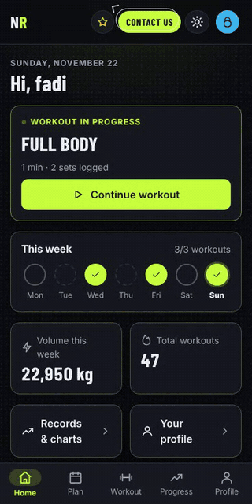
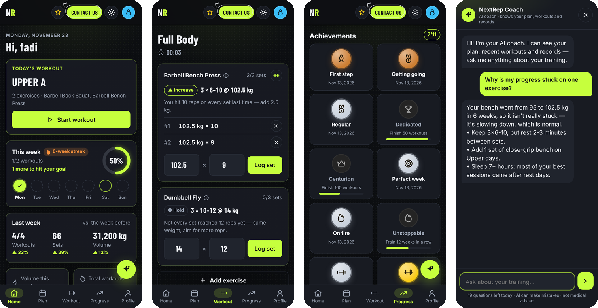
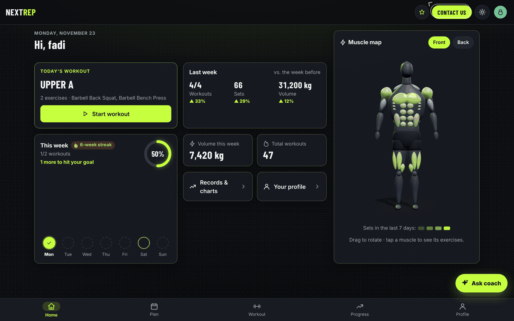
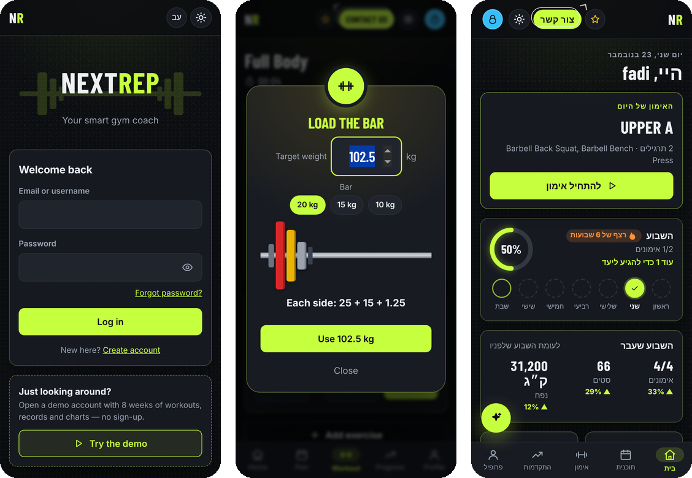
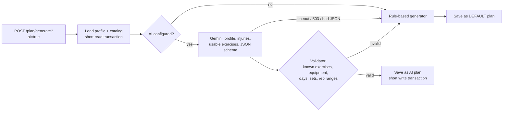

# NextRep

[](https://github.com/fadikazoura/NextRep/actions/workflows/ci.yml)


**A smart gym workout tracker — Spring Boot backend + installable web app.** NextRep builds a personalised weekly
training plan (rule-based or with AI), lets you log every set, tells you **how much to lift next time**, celebrates
personal records and shows your progress — in English or Hebrew, on phone or desktop.

### 🚀 Live demo

**App: https://nextrep-07r6.onrender.com** · API docs: https://nextrep-07r6.onrender.com/swagger-ui.html

> Hosted on free tiers (Render + Neon). An uptime monitor keeps the server awake, but if it has been idle the
> **first load can take up to a minute**. Tap **Try the demo** for a ready account with 8 weeks of workouts — no sign-up — or create your own.

<p align="center">
  
</p>

<p align="center">
  
</p>

<p align="center">
  
</p>

<p align="center">
  
</p>

---

## Features

| | |
|---|---|
| 📅 **Weekly plans** | Rule-based generator (Full Body / Upper-Lower / Push-Pull-Legs) adapted to equipment, goal and time |
| 🤖 **AI plans** | Gemini builds a plan that also respects injuries — validated before saving, with automatic fallback |
| 🏋️ **Workout logging** | Start from a plan day or freestyle, log sets, rest timer, live workout clock |
| 📈 **Progression engine** | Double progression: hit the top of the rep range on every set → add weight; stall 3 times → deload 10% |
| 🏆 **Personal records** | Heaviest set, estimated 1RM (Epley), most reps — with a celebration the moment you beat one |
| 📊 **Progress charts** | Estimated 1RM, top weight and volume per exercise; body-weight history |
| 💬 **AI coach** | Ask questions in English or Hebrew; Gemini answers with your profile, plan, recent workouts and records as context, with guardrails and a daily allowance |
| 🔥 **Streaks & achievements** | Weekly streak, last week vs. the week before, 11 badges with progress bars and an unlock celebration |
| 🗂️ **Workout history** | Every past workout set by set, with "repeat this workout" |
| 🧍 **3D muscle map** | Three.js body coloured by sets per muscle in the last 7 days; tap a muscle to see its exercises |
| 📖 **Exercise guides** | Step-by-step instructions and tips for all 58 exercises, in English and Hebrew |
| 🔩 **Plate calculator** | Which plates to load on each side of the bar, in kg or lb, with the closest loadable weight |
| ⚖️ **kg / lb** | Stored in kg, shown and entered in the unit chosen in the profile |
| 👤 **Accounts** | Username or email login, phone with country code, avatar (presets or photo), data export, delete account |
| 🔑 **Password reset** | 6-digit code sent by email (Brevo), hashed, 15-minute expiry, attempt and rate limits |
| 🔐 **Security** | JWT with token versioning (log out everywhere, revoke on password change), BCrypt, ownership checks |
| 🚦 **Rate limiting** | Per-IP limits on login, sign-up, demo, password reset, contact and AI endpoints (429 + Retry-After) |
| ⭐ **Feedback** | Rate-us pop-up and contact form that emails the support inbox |
| 🌍 **i18n + PWA** | English / Hebrew with full right-to-left layout, light/dark theme, installable on the phone |

## Tech stack

**Backend:** Java 21 · Spring Boot 4.1 · Spring Security 7 (OAuth2 resource server, JWT) · Spring Data JPA /
Hibernate 7 · PostgreSQL 17 · Flyway · Gemini API · Brevo (transactional email) · libphonenumber · springdoc-openapi

**Frontend:** plain JavaScript ES modules (no framework, no build step) · hash routing · Three.js (lazy-loaded) ·
SVG charts and icons · service worker

**Quality & ops:** JUnit 5 · Mockito · MockMvc · Testcontainers · GitHub Actions · Docker · Render + Neon

## Architecture

Package-by-feature: each feature owns its controller, service, entities and DTOs.

```
com.fadikazoura.nextrep
├── auth          register / login, JWT issuing, password reset codes
├── account       account details, password, sessions, avatar, data export, delete account
├── user          training profile
├── bodyweight    daily body-weight log
├── exercise      catalog of 58 exercises with guides
├── plan          plan aggregate, rule-based generator, plan validator
├── ai            Gemini client, prompt + JSON schema, AI plan generator
├── workout       workout sessions and sets
├── progression   double-progression engine and recommendations
├── stats         personal records, progress charts, muscle volume
├── insights      streaks, weekly totals and achievements (derived from the logged sets)
├── demo          one-click demo accounts with sample history, hourly cleanup
├── feedback      app rating and contact messages
├── coach         AI coach: athlete-data briefing for Gemini, guardrails, daily allowance
├── ratelimit     per-IP request limits (servlet filter + in-memory fixed windows)
├── mail          email sending (Brevo API, logging fallback), templates
├── common        error handling (RFC 9457 ProblemDetail), paging
└── config        security, JWT + token-version validator, clock, OpenAPI
```

The web app is served by Spring Boot from `src/main/resources/static`: an `index.html` shell, ES modules per screen,
and a small XSS-safe DOM builder. User text is always inserted as text, never as HTML.

How an AI plan is generated — the AI is an upgrade, never a single point of failure:



## Getting started

**Prerequisites:** Java 21 and Docker.

```bash
# 1. Start PostgreSQL
docker compose up -d db

# 2. (Optional) enable AI plans and real emails
export GEMINI_API_KEY="your-key"     # free key at https://aistudio.google.com
export BREVO_API_KEY="your-key"      # without it, emails are written to the log instead

# 3. Run the app (Flyway creates the schema and seeds the exercise catalog)
./mvnw spring-boot:run
```

Open **http://localhost:8080** for the app, or **http://localhost:8080/swagger-ui.html** for the API.

| Variable | Purpose | Default |
|---|---|---|
| `GEMINI_API_KEY` | Enables AI plans; without it the rule-based generator is used | empty (AI off) |
| `NEXTREP_AI_GEMINI_MODEL` | Gemini model | `gemini-3.1-flash-lite` |
| `BREVO_API_KEY` | Sends password-reset and contact emails; without it they are logged | empty (log only) |
| `JWT_SECRET` | HS256 signing secret (**must** be set in production) | dev-only value |

## API overview

All endpoints except register, login and password reset require `Authorization: Bearer <token>`.

| Area | Endpoints |
|---|---|
| Auth | `POST /api/auth/register` · `POST /api/auth/login` · `POST /api/auth/password-reset` · `POST /api/auth/password-reset/confirm` |
| Account | `GET /api/users/me` · `PUT .../account` · `PUT .../password` · `POST .../sessions/revoke` · `GET .../export` · `DELETE /api/users/me` · `PUT` / `DELETE .../avatar` · `POST` / `GET .../avatar/photo` |
| Profile | `GET` / `PUT /api/users/me/profile` |
| Body weight | `GET` / `PUT /api/users/me/body-weight` |
| Exercises | `GET /api/exercises?muscleGroup=&equipment=` · `GET /api/exercises/{id}` · `GET /api/exercises/{id}/guide` |
| Plan | `POST /api/users/me/plan/generate?ai=true` · `GET /api/users/me/plan` |
| Recommendations | `GET /api/users/me/plan/days/{planDayId}/recommendations` |
| Workouts | `POST /api/users/me/workouts` · `GET .../current` · `GET .../{id}` · `POST .../{id}/sets` · `DELETE .../{id}/sets/{setId}` · `POST .../{id}/complete` · `DELETE .../{id}` · `GET /api/users/me/workouts?page=&size=` |
| Stats | `GET /api/users/me/records` · `GET /api/users/me/exercises/{id}/progress` · `GET /api/users/me/muscles/volume?days=7` · `GET /api/users/me/insights?tz=&firstDay=` |
| Feedback | `GET` / `PUT /api/users/me/rating` · `POST /api/users/me/contact` |
| Coach | `POST /api/users/me/coach?tz=` (question, recent turns, language) |

Errors use a consistent [RFC 9457](https://www.rfc-editor.org/rfc/rfc9457) `ProblemDetail` body, with field-level
messages for validation errors.

## Design decisions

- **AI output is untrusted input.** Gemini answers in a fixed JSON schema, and every plan is validated (exercise ids
  exist, equipment matches, exact training days, no duplicates, sane sets and rep ranges) before it is saved.
  Free-text injuries are passed to the model as data, not instructions.
- **Graceful degradation.** Timeouts, overloaded models, invalid answers or a missing key all fall back to the
  rule-based generator — the user always gets a plan. The same idea applies to email (log fallback) and to the 3D
  muscle map (an SVG body when WebGL is unavailable).
- **No transaction around remote calls.** The AI call runs between a short read and a short write transaction, and
  emails are sent by a `@TransactionalEventListener` only after the commit succeeds.
- **Revocable stateless tokens.** Each JWT carries a `ver` claim that must match `users.token_version`; bumping the
  version logs the user out everywhere (password change, "log out all devices", account deletion).
- **Password reset done carefully.** Codes are BCrypt-hashed, expire in 15 minutes, allow 5 attempts and 3 requests
  an hour, and the response is identical whether or not the email exists (no account enumeration).
- **Dependency inversion.** The `plan` module defines a `SmartPlanGenerator` interface and the `ai` module implements
  it; `mail` hides the email provider behind a `MailSender` interface.
- **Rules enforced by the database too.** Partial unique indexes guarantee one active plan and one open workout per
  user, a case-insensitive unique username, and check constraints guard ranges and phone format (E.164).
- **One unit in storage.** Weights are stored in kg as `NUMERIC` (never `double`); the UI converts to lb for display
  and back to kg on input.
- **Derived data instead of duplicated data.** Personal records and muscle volume are computed from logged sets with
  `GROUP BY` in the database, so they can never go out of sync.
- **Security by default.** Every `/me` endpoint takes the user id from the JWT; other users' resources return 404,
  uploaded images are checked by their magic bytes, user text in emails is HTML-escaped, and secrets come only from
  environment variables.
- **The AI coach is grounded and fenced in.** Each question goes to Gemini with a short briefing built from the
  athlete's own data (no name, email or phone). The rules live in the system instruction, which users can't see or
  change; their words travel as conversation content, so "ignore your instructions" is just text. It stays on
  training topics, never diagnoses, and each user gets 20 questions a day — a failed AI call doesn't count.
- **Rate limiting where abuse is cheap.** A servlet filter in front of Spring Security caps logins, sign-ups,
  demo accounts, password resets, contact messages and AI calls per IP, and answers 429 with Retry-After. The
  visitor IP comes from Cloudflare's True-Client-IP on Render, not X-Forwarded-For, which clients can forge.
  Counters are in memory (one instance); several instances would share them through Redis.
- **Fresh after every deploy.** Static files are served with `Cache-Control: no-cache` + `Last-Modified`, so browsers
  revalidate (cheap 304s) and see a new release immediately; the API is never cached by the service worker.

## Testing

```bash
./mvnw verify
```

230+ automated tests:

- **Unit tests** for the pure logic: plan generator, progression engine, personal records, plan validator,
  AI prompt and response handling, email templates.
- **Integration tests** through the full HTTP → service → database stack with **MockMvc** and a real
  **PostgreSQL in Docker (Testcontainers)** — including token revocation, password reset limits and data export.
- **No real external calls in tests**: Gemini and Brevo clients are tested against `MockRestServiceServer`, and
  tests run with emails switched to the logging sender.
- **End-to-end tests (Playwright)** drive a real browser through the app — sign-up, profile, plan, logging a
  workout and seeing the new record, the demo account, Hebrew/RTL — on a desktop and a phone viewport, against
  the real server and database. Run them with `cd e2e && npm ci && npx playwright install chromium && npm test`.
- **CI**: GitHub Actions runs the whole suite on every push and pull request: the Maven build and, in a second
  job, the app started from its jar with PostgreSQL, tested end to end in Chromium.

## Roadmap

- [x] Docker image and cloud deployment (Render + Neon, auto-deploy from `main`)
- [x] Web UI (plans, workout logging, progress charts), PWA, English/Hebrew
- [x] Accounts, avatars, password reset by email, feedback
- [x] Achievement badges, streaks and a weekly summary
- [ ] Workout reminders (push notifications)
- [x] End-to-end UI tests (Playwright) in CI
- [ ] Refresh tokens and per-user time zones

## Author

**Fadi Kazoura** — Software Engineering student, Braude College of Engineering

[](https://www.linkedin.com/in/fadi-kazoura-7a525335b)
